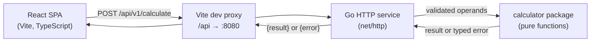

# Architecture

Status: implemented. This document describes the code as built, last updated
during M6 (classic keypad UI).

## High-level



## Boundaries and responsibilities

| Component | Responsibility |
| --- | --- |
| React UI (`src/components`, `src/App.tsx`) | Classic keypad, immediate-execution state machine, presentation, loading/error states. |
| API client (`src/api`) | HTTP request shape, JSON parsing, typed `ApiError`. |
| Go API (`internal/api`) | Routing, strict JSON decoding, status codes, error envelope. |
| Calculator core (`internal/calculator`) | Arithmetic, arity validation, numeric domain rules. |
| Config (`internal/config`) | Read `PORT` with a default. |

Business arithmetic exists only in the backend. The frontend collects operands
and displays returned numbers; it never computes a result. Digit entry, sign
toggle, and backspace are string edits on the display value, not arithmetic.

## Request flow

1. User presses an operator key with a pending operation still unevaluated; the
   component sends the pending `{operation, a, b}` for evaluation first.
2. `fetch` sends `POST /api/v1/calculate` (same origin, proxied in development).
3. Backend decodes strictly (single JSON value, known fields, size limit),
   validates operation and arity, then calls the calculator core.
4. Success returns `200 {"result": number}`; domain errors return `400` with
   `{"error": {"code", "message"}}`.
5. Frontend formats the returned number into the display and keeps it as the
   next operand.

Key mapping (immediate execution, no precedence):

| Key | Request |
| --- | --- |
| `+ − × ÷ %` then `=` | `{operation, a: left, b: right}` on `=` |
| `√` | `{operation: "sqrt", a}` immediately |
| `x²` | `{operation: "power", a, b: 2}` immediately |
| `xʸ` | `{operation: "power", a: left, b: right}` on `=` |
| `1/x` | `{operation: "divide", a: 1, b}` immediately |

Pressing a binary operator while a previous operation is pending evaluates that
operation first, so `2 + 3 × 4 =` returns 20 (left to right). All keys are
disabled while a request is in flight, which prevents duplicate submissions.

## Validation ownership

- **Frontend (usability):** which keys are available and when, plus the display
  grammar (single decimal point, sign toggle, backspace).
- **Backend (authoritative):** JSON structure, operation support, operand
  presence/arity, finite inputs, division by zero, domain errors (negative
  sqrt), finite results.
- The backend never trusts frontend validation.

## Error handling

One error envelope everywhere:

```json
{ "error": { "code": "DIVISION_BY_ZERO", "message": "Cannot divide by zero" } }
```

Domain errors (bad input/arithmetic) are `400`. Unknown route `404`, wrong
method `405`, oversized body `413`, unexpected panic `500`. Stack traces and
internal details are never returned.

## Configuration

- Backend: `PORT` (default `8080`), optional `LOG_REQUESTS` not implemented.
- Frontend: `VITE_API_BASE_URL` (default empty → same-origin `/api/...`);
  Vite dev server proxies `/api` to `http://localhost:8080`.

## Testing strategy

- **Go unit tests:** pure calculator functions, table-driven, normal and
  exceptional cases.
- **Go HTTP tests:** `httptest` against the real router for status codes,
  content types, strict decoding, and error envelopes.
- **Frontend tests:** Vitest + React Testing Library with the API module mocked;
  no arithmetic re-implementation in tests.
- **Integration:** shell smoke test hits a real server with curl, including one
  error path.

## Trade-offs

- Standard-library HTTP instead of a router framework: fewer dependencies, the
  routing surface is tiny.
- No database or state: calculations are stateless; the assignment needs none.
- Percentage defined as `a / b * 100` ("what percent of b is a") and a zero
  denominator is an error, avoiding ambiguous semantics.
- No CORS middleware: development uses the Vite proxy, production is expected
  to serve both from one origin. Narrow CORS can be added if deployment splits
  origins.
